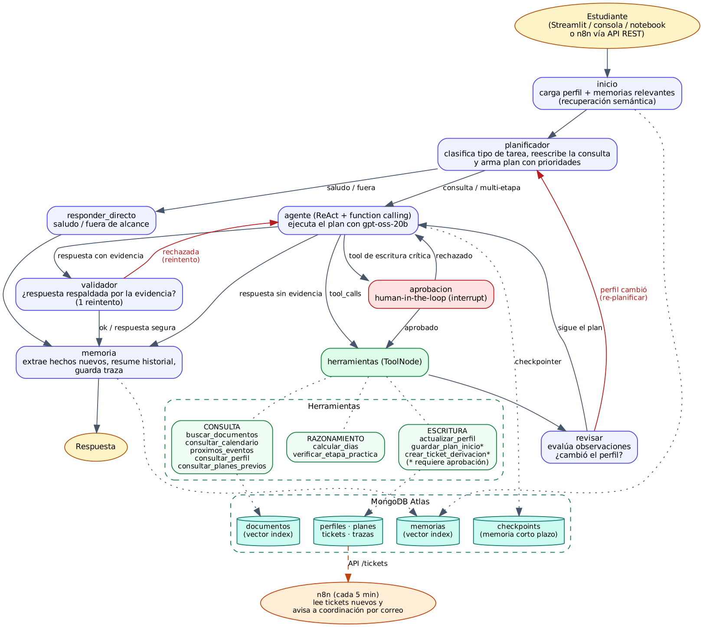

# DuocAIAgent · Evaluación Parcial 2

Agente inteligente que orienta a estudiantes nuevos de **Duoc UC** (prácticas, calendario académico 2026 y reglamento)
y que, además de responder, **arma y guarda un plan personal con fechas**, **deriva casos a coordinación** y
**recuerda al estudiante entre conversaciones**.

Asignatura: Ingeniería de Soluciones con IA (ISY0101) · Integrantes: Joaquin Herrera y Roberto Bustos.

## Requerimiento organizacional

En marzo y julio Punto Estudiantil recibe muchas consultas repetidas de alumnos nuevos ("¿cuándo es la toma de ramos?",
"¿cuándo me toca la práctica?"). La información existe pero está repartida en documentos largos. El flujo que automatiza el agente es:

1. El estudiante pregunta o pide ayuda para organizar su semestre.
2. El agente identifica qué tipo de tarea es y planifica los pasos.
3. Consulta los documentos oficiales y el calendario, razona sobre fechas y la etapa de prácticas.
4. Si corresponde, **escribe**: guarda el perfil, un plan con fechas (.md + .ics) o un ticket para coordinación (con autorización del estudiante).
5. Si no encuentra la respuesta, no inventa: lo dice y ofrece derivar el caso.
6. Recuerda lo conversado para la próxima vez.

## Arquitectura



El agente es un **grafo de LangGraph** con estado compartido (`agente/estado.py`). Cada nodo hace una cosa:

| Nodo | Qué hace |
|---|---|
| `inicio` | Lee el perfil del estudiante y busca por similitud las memorias más relevantes para la pregunta (memoria de largo plazo) |
| `planificador` | Clasifica la tarea (`saludo`, `fuera_de_alcance`, `consulta_simple`, `multi_etapa`, `dato_personal`), reescribe la consulta usando el historial y arma un plan de pasos con prioridad (salida estructurada con Pydantic) |
| `responder_directo` | Saludos y preguntas fuera de alcance, sin herramientas |
| `agente` | LLM con function calling que ejecuta el plan en ciclo ReAct (piensa → llama herramienta → observa → sigue) |
| `aprobacion` | Human-in-the-loop: antes de una herramienta de escritura crítica el grafo se pausa (`interrupt`) y espera que el estudiante autorice |
| `herramientas` | `ToolNode` que ejecuta las herramientas |
| `revisar` | Evalúa las observaciones (sin resultados, errores), marca los pasos del plan como hechos y detecta si el perfil cambió a mitad de la tarea → **re-planifica** |
| `validador` | Revisa que la respuesta esté respaldada por la evidencia de las herramientas; si no, la borra y da un reintento; si vuelve a fallar responde que no tiene la información y ofrece ticket |
| `memoria` | Extrae hechos nuevos del estudiante y los guarda con embedding, resume la conversación cuando se alarga y guarda la traza |

### Componentes y por qué

| Componente | Elección | Justificación |
|---|---|---|
| Framework de agentes | **LangGraph** + LangChain | Permite definir el flujo como grafo con aristas condicionales (decisiones), trae checkpointer (memoria corta persistente), `interrupt` (human-in-the-loop) y `recursion_limit` (evita bucles). Es el framework visto en las clases 2.2 a 2.5. Se probó AutoGen (`notebooks/multiagente.ipynb` del proyecto base) pero para este flujo necesitábamos control explícito de cada etapa |
| LLM | `openai/gpt-oss-20b` en **Groq** | Gratis, rápido y con buen soporte de function calling. `llama-3.1-8b-instant` ya no está disponible en el plan gratis de Groq y además fallaba más con varias herramientas |
| LLM juez | `openai/gpt-oss-120b` | Para la evaluación (LLM-as-judge) conviene un modelo más grande que el evaluado |
| Base de datos | **MongoDB Atlas** | Una sola base para vectores (Atlas Vector Search), memoria, perfiles, planes, tickets, trazas y checkpoints de LangGraph (`langgraph-checkpoint-mongodb`) |
| Embeddings | `paraphrase-multilingual-MiniLM-L12-v2` (local) | Multilingüe, sin costo y no envía los documentos a terceros. Se usa para documentos y memorias |
| Reranker | `cross-encoder/mmarco-mMiniLMv2-L12-H384-v1` | Reordena los candidatos del vector search (clase 1.3) |
| UI | Streamlit | Chat con el razonamiento visible, botones de autorización, panel de tickets y descarga de planes |

## Herramientas

| Tipo | Herramienta | Descripción |
|---|---|---|
| Consulta | `buscar_documentos` | Vector search en reglamento, calendario y prácticas (filtro opcional por fuente) + reranker |
| Consulta | `consultar_calendario` | Fechas exactas del calendario 2026 (parseado del PDF), con estado vigente / próximo / terminado y días que faltan |
| Consulta | `proximos_eventos` | Eventos vigentes o que empiezan en los próximos N días |
| Consulta | `consultar_perfil`, `consultar_planes_previos` | Leen la memoria de largo plazo del estudiante |
| Razonamiento | `calcular_dias` | Días entre hoy y una fecha (el LLM no hace aritmética de fechas) |
| Razonamiento | `verificar_etapa_practica` | Reglas del documento de prácticas según semestre y tipo de carrera |
| Escritura | `actualizar_perfil` | Guarda o corrige carrera, jornada, semestre, sede, nombre |
| Escritura (con aprobación) | `guardar_plan_inicio` | Guarda el plan en Mongo y genera `salidas/*.md` y `salidas/*.ics` (importable a Google Calendar / Outlook) |
| Escritura (con aprobación) | `crear_ticket_derivacion` | Crea un ticket para coordinación (pestaña "Panel coordinador") |

Los parámetros de cada herramienta se validan con tipos (`Literal`, `int`, modelos Pydantic), así el LLM no puede mandar
por ejemplo un período que no existe.

## Memoria y recuperación de contexto

| Memoria | Dónde vive | Cuándo se lee | Cuándo se escribe |
|---|---|---|---|
| Corto plazo (conversación) | Colección `checkpoints` (MongoDBSaver), por `thread_id` | En cada paso del grafo | Automáticamente después de cada nodo |
| Ventana + resumen | Campo `resumen` del estado | Al planificar y responder (solo los últimos 10 mensajes + el resumen) | Cuando la conversación pasa de 16 mensajes, los antiguos se resumen y se eliminan del estado |
| Largo plazo: perfil | Colección `perfiles` | Nodo `inicio` | Herramienta `actualizar_perfil` |
| Largo plazo: hechos | Colección `memorias` (con embedding y vector index filtrado por `user_id`) | Nodo `inicio`: busca las 4 más parecidas a la pregunta (**recuperación semántica**) | Nodo `memoria`: el LLM extrae hechos nuevos ("reprobó Matemáticas en 2026-1") |
| Episódica | Colecciones `planes`, `tickets`, `trazas` | `consultar_planes_previos`, panel de Streamlit | Herramientas de escritura y nodo `memoria` |

Además, el planificador **reescribe la consulta** con el historial ("¿y la profesional?" → "¿cuántas horas dura la práctica profesional?").

## Planificación y decisiones adaptativas

El agente sigue un esquema **plan-and-execute con re-planificación**:

- El planificador devuelve un plan priorizado, por ejemplo para "ármame un plan para este semestre":
  `1. consultar_perfil → 2. verificar_etapa_practica → 3. consultar_calendario → 4. guardar_plan_inicio`.
- El agente lo ejecuta en ciclo ReAct y evalúa cada resultado antes de seguir.
- Reglas de adaptación implementadas:

| Condición | Comportamiento |
|---|---|
| Saludo o tema fuera de Duoc | Ruta corta sin herramientas |
| Falta un dato del perfil necesario | Pregunta al estudiante en vez de suponer |
| Herramienta sin resultados | Reformula una vez; si sigue sin resultados, lo dice y ofrece ticket |
| Herramienta con error | No repite los mismos argumentos |
| El estudiante corrige su perfil a mitad de la tarea | `revisar` detecta el cambio y vuelve al planificador (máximo 1 re-planificación por turno) |
| Herramienta de escritura crítica | Pausa y pide autorización; si la rechaza, sigue sin escribir |
| Respuesta no respaldada | El validador la descarta y da 1 reintento; luego respuesta segura |
| El modelo falla (por ejemplo una tool call mal formada en Groq) | Reintenta hasta 3 veces y si no, responde con un mensaje de error controlado |
| Bucles | `recursion_limit = 30` |

Todas las decisiones quedan en el campo `decisiones` del estado y se muestran en el expander "Razonamiento del agente" de Streamlit
y en la colección `trazas`.

### Ejemplo de flujo (condición cambiante)

```
Estudiante: "Perdón, voy en cuarto semestre, no en segundo. ¿Cambia algo de mis prácticas?"
· Memoria cargada: perfil con 4 dato(s) y 2 memoria(s) relevante(s).
· Planificación: tipo=multi_etapa. Pasos: actualizar_perfil → verificar_etapa_practica
· Observación de actualizar_perfil: OK.
· Condición cambiante: el perfil cambió durante la tarea → se vuelve a planificar.
· Re-planificación: tipo=multi_etapa. Pasos: verificar_etapa_practica → consultar_calendario
· Observación de verificar_etapa_practica: OK.
· Validador: respuesta respaldada por la evidencia.
```

## Estructura

```
├── agente/
│   ├── config.py          variables de entorno
│   ├── estado.py          AgentState del grafo
│   ├── grafo.py           nodos, rutas y compilación del grafo
│   ├── orquestador.py     interfaz para la app, la consola y el notebook
│   ├── herramientas.py    las 10 herramientas
│   ├── prompts.py         prompts del planificador, agente, validador y memoria
│   ├── db.py              MongoDB Atlas (colecciones e índices vectoriales)
│   ├── ingesta.py         PDFs/web → chunks → embeddings
│   ├── retrieval.py       vector search + reranker
│   ├── calendario.py      parser del calendario 2026
│   ├── embeddings.py, llm.py, fechas.py, servicios.py
├── app.py                 app Streamlit
├── api.py                 API REST (FastAPI) que usa n8n
├── n8n/                   flujos de n8n listos para importar
├── chat.py                chat por consola
├── ingesta.py             carga de documentos
├── DuocAIAgent_EV2.ipynb  notebook con todo el flujo y los escenarios
├── eval/                  dataset (18 casos) y script de evaluación
├── tests/                 pytest (con LLM y BD falsos, no gastan tokens)
├── docs/                  diagrama de orquestación, evidencia de tests y borrador del informe
├── data/                  PDFs internos y URLs externas
└── salidas/               planes generados (.md y .ics)
```

## Cómo ejecutarlo (Windows / PowerShell)

```powershell
cd C:\Jupyter\DuocAIAgent_EV2
py -3.12 -m venv .venv
.venv\Scripts\Activate.ps1
python -m pip install --upgrade pip
pip install torch --index-url https://download.pytorch.org/whl/cpu
pip install -r requirements.txt
copy .env.example .env
```

En el `.env` completar `GROQ_API_KEY` y en `MONGODB_URI` reemplazar `<db_password>` por la clave del usuario de la base de datos.
En Atlas → Network Access hay que tener permitida la IP actual.

```powershell
python ingesta.py --sin-externas    # 1. carga los PDFs y crea los índices vectoriales (la primera vez descarga el modelo)
streamlit run app.py                # 2. app de chat en http://localhost:8501
python chat.py --usuario camila     # (opcional) chat por consola
jupyter notebook DuocAIAgent_EV2.ipynb   # (opcional) todo paso a paso
python -m eval.escenarios           # 3. corre 8 escenarios y deja la evidencia de decisiones en eval/resultados/
python -m eval.evaluar              # 4. evaluación con métricas, deja resultados en eval/resultados/
python -m pytest -q                 # 5. tests
uvicorn api:app --port 8000         # (opcional) API para n8n, ver "Integración con n8n"
```

`FECHA_HOY` (formato `AAAA-MM-DD`) en el `.env` permite simular otra fecha, por ejemplo `2026-07-20` para probar qué
pasa justo antes de la inscripción de asignaturas del segundo semestre.

> Atlas M0 (gratis) permite hasta 3 índices de búsqueda por cluster. Este proyecto crea 2 (`vector_index_documentos` y
> `vector_index_memorias`) en la base `duoc-ai-agent-ev2`.

## Integración con n8n

El agente sigue corriendo en LangGraph. n8n se usa para conectarlo con el flujo de la institución: recibir consultas por
webhook y avisar a coordinación cuando el agente deriva un caso. Para eso hay una API en `api.py`:

| Método | Ruta | Qué hace |
|---|---|---|
| GET | `/salud` | revisa que la API esté arriba |
| POST | `/preguntar` | `{usuario, mensaje, conversacion?}` → respuesta, plan, herramientas, fuentes y si queda algo pendiente de aprobación |
| POST | `/aprobar` | `{conversacion, aprobado}` → autoriza o rechaza la acción crítica pendiente (guardar plan o crear ticket) |
| GET | `/tickets/por-notificar` | tickets abiertos que todavía no se avisaron a coordinación |
| POST | `/tickets/{numero}/notificado` | marca el ticket como avisado |

Si `API_KEY` tiene valor en el `.env`, todas las rutas menos `/salud` piden el header `X-API-Key`.

Flujos en `n8n/`:

1. `01_consultas_webhook.json`: Webhook `POST /webhook/duocaiagent/preguntar` → API `/preguntar` → IF `pendiente_aprobacion`
   → responde la respuesta o avisa que falta autorizar. Un segundo webhook `POST /webhook/duocaiagent/aprobar` manda la
   decisión a `/aprobar`.
2. `02_aviso_tickets.json`: cada 5 minutos consulta `/tickets/por-notificar`, manda un correo a coordinación por cada
   ticket y lo marca como notificado para no repetir el aviso.

Cómo levantarlo:

```powershell
uvicorn api:app --port 8000          # 1. API del agente (docs en http://localhost:8000/docs)
npx n8n                              # 2. n8n en http://localhost:5678 (o con Docker, ver abajo)
```

En n8n: *Workflows → Import from File* y elegir los dos JSON. Después:

- En los nodos HTTP cambiar `cambiar-por-tu-api-key` por el valor de `API_KEY` (o borrar el header si se dejó vacío).
- Si n8n corre en Docker (`docker run -it --rm -p 5678:5678 n8nio/n8n`), cambiar `localhost:8000` por
  `host.docker.internal:8000`.
- En el nodo *Enviar correo* crear una credencial SMTP (por ejemplo Gmail con contraseña de aplicación) y poner el correo
  de destino.
- Activar los dos flujos.

Prueba del flujo 1:

```powershell
Invoke-RestMethod -Method Post -Uri http://localhost:5678/webhook/duocaiagent/preguntar -ContentType "application/json" -Body '{"usuario":"camila","mensaje":"¿cuándo empieza el segundo semestre?"}'
```

## Evaluación

`eval/dataset.json` tiene 18 casos en categorías `rag`, `calendario`, `razonamiento`, `memoria`, `escritura`,
`sin_informacion` y `no_tool`. Se miden:

- **Planner accuracy**: el planificador clasificó bien el tipo de tarea.
- **Tool accuracy**: usó las herramientas esperadas (y ninguna en los casos `no_tool`).
- **Answer accuracy**: LLM-as-judge (`gpt-oss-120b`) compara con la respuesta esperada.
- **Retrieval hit@5**: en las preguntas RAG, si entre los 5 fragmentos recuperados hay uno de la fuente correcta.

Los resultados quedan en `eval/resultados/` (`.json` y `.md`) y se ven en la pestaña **📊 Evaluación** de la app.

## Evidencia de decisiones adaptativas

`python -m eval.escenarios` corre 8 escenarios con el agente real (consulta simple, datos personales, plan multi-etapa con
escritura aprobada, corrección del semestre que obliga a re-planificar, información inexistente, escritura rechazada,
continuidad en una conversación nueva y fuera de alcance) y guarda en `eval/resultados/escenarios_*.md` el plan, las
herramientas, las autorizaciones y cada decisión del agente.

En los casos de escritura la evaluación rechaza la autorización, así no se crean planes ni tickets de prueba.

## Tests

`tests/` usa un LLM falso con respuestas programadas y una base en memoria, así se prueban las rutas del grafo sin gastar
tokens: consulta simple, saludo, fuera de alcance, aprobación aceptada y rechazada, re-planificación por cambio de perfil,
validador que rechaza dos veces, memoria entre conversaciones, historial y resumen. También se prueban las herramientas,
la ingesta con los PDFs reales y la capa de MongoDB con `mongomock`.

## Solución de problemas

| Síntoma | Qué hacer |
|---|---|
| `Falta MONGODB_URI` / `Falta GROQ_API_KEY` | Revisar que el `.env` esté en la raíz del proyecto y reiniciar la app o el kernel |
| `ServerSelectionTimeoutError` | En Atlas: cluster pausado, IP no permitida (Network Access) o clave mal escrita. En la red de Duoc a veces se bloquea; probar con el hotspot del celular |
| `bad auth : authentication failed` | La clave de `MONGODB_URI` es la del usuario de la base, no la de la cuenta de Atlas |
| La búsqueda no devuelve nada recién hecha la ingesta | El índice vectorial se está construyendo; esperar un minuto (Atlas → Search debe decir *Active*) |
| `Error code: 429` de Groq | Límite de tokens por minuto del plan gratis; esperar o subir `--pausa` en la evaluación |
| `tool_use_failed` de Groq | El agente reintenta solo; si persiste, volver a preguntar |
| `ModuleNotFoundError: agente` | Ejecutar los comandos desde la carpeta del proyecto |

## Limitaciones

- Las etapas de práctica son referenciales: el documento dice "generalmente", y la malla de cada carrera manda.
- El calendario solo cubre 2026.
- El plan gratis de Groq tiene límite de tokens por minuto; en la evaluación hay una pausa entre casos.
- El validador también es un LLM, así que puede equivocarse (por eso solo hace 1 reintento).

## Referencias

- Chase, H. (2022). *LangChain* [Software]. https://github.com/langchain-ai/langchain
- LangChain Inc. (2024). *LangGraph* [Software]. https://github.com/langchain-ai/langgraph
- MongoDB Inc. (2024). *Atlas Vector Search*. https://www.mongodb.com/docs/atlas/atlas-vector-search/
- Groq Inc. (2025). *GroqCloud API documentation*. https://console.groq.com/docs
- OpenAI. (2025). *gpt-oss-120b & gpt-oss-20b model card*. https://openai.com/index/gpt-oss-model-card/
- Reimers, N., & Gurevych, I. (2019). Sentence-BERT: Sentence embeddings using Siamese BERT-networks. *Proceedings of EMNLP-IJCNLP 2019*.
- Yao, S., Zhao, J., Yu, D., Du, N., Shafran, I., Narasimhan, K., & Cao, Y. (2023). ReAct: Synergizing reasoning and acting in language models. *ICLR 2023*.
- Wang, L., Xu, W., Lan, Y., Hu, Z., Lan, Y., Lee, R. K.-W., & Lim, E.-P. (2023). Plan-and-solve prompting. *ACL 2023*.
- Duoc UC. (2026). *Reglamento Académico* y *Calendario Académico 2026* [Documentos internos].
